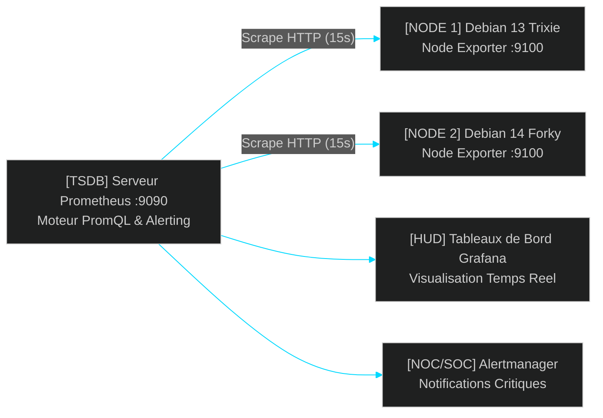

<!-- MASTER-HEADER-START -->
<div align="center">

<a href="https://0xcyberlitech.com/">
  
</a>

<p align="center">
  <a href="https://0xcyberlitech.com/"></a>
  <a href="https://0xcyberlitech.com/soc-rd.html"></a>
  <a href="https://0xcyberlitech.com/jarvis-rd.html"></a>
  <a href="https://github.com/0xCyberLiTech?tab=repositories"></a>
</p>
<p align="center">
  <a href="README.md"></a>
</p>


</div>
<!-- MASTER-HEADER-END -->

<!-- DEBIAN-TRUTH-START -->
> [!IMPORTANT]
>  ** Matrice Officielle Debian — `Debian 12 (Bookworm)` · `Debian 13 (Trixie)` · `Debian 14 (Forky)`**
> - **Sources Officielles Debian.org (`prometheus`) :** `Bookworm (12)` : **`2.42.0+ds-5+deb12u1`** &nbsp;·&nbsp; `Trixie (13 — Stable)` : **`2.53.3+ds1-2`** &nbsp;·&nbsp; `Forky (14 — Next-Gen)` : **`3.5.3+ds1-6`**
> - **Références Officielles :** [Paquet Debian Trixie (`prometheus`)](https://packages.debian.org/trixie/prometheus) &nbsp;·&nbsp; [Paquet Debian Forky (`prometheus`)](https://packages.debian.org/forky/prometheus) &nbsp;·&nbsp; [Documentation Officielle Debian](https://packages.debian.org/trixie/admin/)
> - **Note d'Ingénierie (Divergence 13 vs 14) :** Debian 13 (Trixie) et Debian 14 (Forky) fonctionnent exclusivement en **cgroups v2 unifiés**, permettant à `systemd-cgtop` et aux agents de supervision (Zabbix, Checkmk, Nagios) de mesurer finement la pression CPU/RAM/IO (`PSI`).

<details>
<summary> <b>Afficher les Encarts Ligne de Commande : Debian 13 (Trixie — Stable) vs Debian 14 (Forky — Next-Gen)</b></summary>

####  Profil Production Stable — Commandes pour `Debian 13 (Trixie)`
```bash
# Debian 13 (Trixie) — Verification temps reel des unites de supervision & sockets :
systemctl list-units --type=service --state=running
ss -tulpn
```

####  Profil Anticipation Next-Gen — Commandes pour `Debian 14 (Forky)`
```bash
# Debian 14 (Forky) — Analyse de performance & empreinte mémoire par cgroup v2 :
systemd-cgtop -n 1
journalctl --disk-usage
```

</details>
<!-- DEBIAN-TRUTH-END -->

<!-- CIEL-PEDAGOGY-START -->
<details>
<summary> <b>Synthèse d'Architecture, Standards Officiels &amp; Diagnostic (Niveau 1 : Fondamentaux · Niveau 2 : Repères · Niveau 3 : Diagnostic)</b></summary>

- **Niveau 1 — Fondamentaux &amp; Principe d'Architecture :** L'architecture de **Supervision & Observabilité** structure la surveillance du système d'information autour de trois piliers complémentaires : les **Métriques** (séries temporelles de performance), les **Journaux** (événements horodatés) et la **Disponibilité** (contrôles de bout en bout et SLA).
- **Niveau 2 — Repères Officiels (Ports IANA, Fichiers Debian &amp; Commandes de Validation) :** **Protocoles normalisés :** `ICMP` (Latence et perte) · `SNMPv3` (`UDP 161` en mode `authPriv` SHA/AES) · `Syslog RFC 5424` (`TCP/TLS 6514`) · Agents télémétriques (`10050/tcp`, `6556/tcp`, `5666/tcp`).
- **Niveau 3 — Diagnostic d'Incidents &amp; Ingénierie Avancée :** **Diagnostic & Architecture :** En environnement de production, bannissez `SNMPv1/v2c` (chaîne de communauté transmise en clair sur le réseau) au profit exclusif de **SNMPv3 (`authPriv`)**. Combinez systématiquement seuils statiques d'alerte (Disque > 85 %) et analyse de tendance pour anticiper les saturations.
- **Sources de Vérité Officielles Éditeurs &amp; Standards :** [Guide ANSSI — Sécurisation de l'Administration & Supervision](https://cyber.gouv.fr/) &nbsp;·&nbsp; [RFC 3414 (SNMPv3 USM)](https://datatracker.ietf.org/doc/html/rfc3414)

</details>
<!-- CIEL-PEDAGOGY-END -->


#  Supervision Moderne par Métriques avec Prometheus & Node Exporter (Debian 13 Trixie & Debian 14 Forky)

##  01 // PRÉSENTATION & ARCHITECTURE DE PROMETHEUS SOUS DEBIAN 13 & 14


**Prometheus** est le standard open-source de référence (CNCF) pour la supervision par séries temporelles (*Time-Series Database — TSDB*) et l'observabilité haute fréquence des infrastructures Linux, conteneurs Docker et clusters Proxmox.

Contrairement aux moteurs classiques par sondes d'état (Nagios), Prometheus fonctionne selon un modèle **Pull HTTP** :
- **`prometheus-node-exporter` (Port `9100/TCP`) :** Agent léger installé sur chaque serveur **Debian 13 (Trixie)** ou **Debian 14 (Forky)** qui expose en temps réel les métriques du noyau Linux (`/proc`, `/sys`, pression `PSI` cgroups v2, CPU, RAM, IOPS disques, états des unités `systemd`).
- **`prometheus` (Port `9090/TCP`) :** Serveur central qui moissonne (*scrape*) les métriques toutes les 15 secondes, évalue les règles d'alerte en langage **PromQL** et alimente les tableaux de bord **Grafana**.



---

##  02 // INSTALLATION DE PROMETHEUS & NODE EXPORTER SUR DEBIAN 13 / 14


Debian maintient nativement dans ses dépôts officiels (`trixie` et `forky`) le serveur Prometheus ainsi que l'agent Node Exporter :

<!-- CODE-WINDOW-START -->
> [!CAUTION]
> 
>
> ```bash
> sudo apt update
> sudo apt install -y prometheus prometheus-node-exporter
> sudo systemctl enable --now prometheus prometheus-node-exporter
> ```
<!-- CODE-WINDOW-END -->

Vérifiez immédiatement que l'agent `node_exporter` expose bien les métriques locales sur le port `9100` :

<!-- CODE-WINDOW-START -->
> [!CAUTION]
> 
>
> ```bash
> sudo systemctl status prometheus prometheus-node-exporter --no-pager
> curl -s http://127.0.0.1:9100/metrics | head -n 25
> ```
<!-- CODE-WINDOW-END -->

---

##  03 // CONFIGURATION DE LA COLLECTE (`/etc/prometheus/prometheus.yml`)


Éditez le fichier `/etc/prometheus/prometheus.yml` pour déclarer vos serveurs Debian à superviser :

<!-- CODE-WINDOW-START -->
> [!CAUTION]
> 
>
> ```yaml
> global:
>   scrape_interval: 15s
>   evaluation_interval: 15s
>
> scrape_configs:
>   - job_name: 'prometheus_master'
>     static_configs:
>       - targets: ['localhost:9090']
>
>   - job_name: 'debian_infrastructure_nodes'
>     static_configs:
>       - targets:
>           - 'localhost:9100'
>           - '192.168.1.10:9100'
>           - '192.168.1.20:9100'
>         labels:
>           env: 'production'
>           os: 'debian-trixie-forky'
> ```
<!-- CODE-WINDOW-END -->

Vérifiez la validité syntaxique du fichier avec `promtool` avant de recharger le service :

<!-- CODE-WINDOW-START -->
> [!CAUTION]
> 
>
> ```bash
> promtool check config /etc/prometheus/prometheus.yml
> sudo systemctl reload prometheus
> ```
<!-- CODE-WINDOW-END -->

---

##  04 // REQUÊTES ESSENTIELLES `PROMQL` POUR LE DIAGNOSTIC SYSTÈME


Utilisez ces expressions **PromQL** dans l'interface Web Prometheus (`http://<IP_SERVEUR>:9090`) ou dans Grafana pour surveiller vos seuils critiques :

<!-- CODE-WINDOW-START -->
> [!CAUTION]
> 
>
> ```yaml
> # 1. Taux d'utilisation CPU global (%) sur les 5 dernières minutes
> 100 - (avg by(instance) (rate(node_cpu_seconds_total{mode="idle"}[5m])) * 100)
>
> # 2. Taux d'occupation de la mémoire vive RAM (%)
> (1 - (node_memory_MemAvailable_bytes / node_memory_MemTotal_bytes)) * 100
>
> # 3. Espace disque utilisé (%) sur la partition racine /
> 100 - ((node_filesystem_avail_bytes{mountpoint="/",fstype!="tmpfs"} * 100) / node_filesystem_size_bytes{mountpoint="/",fstype!="tmpfs"})
>
> # 4. Unités systemd en état d'échec (failed) sur Debian 13 / 14
> node_systemd_unit_state{state="failed"} == 1
> ```
<!-- CODE-WINDOW-END -->

<!-- MASTER-FOOTER-START -->
<div align="center">


<a href="https://0xcyberlitech.com/">
  
</a>

<p align="center"><a href="https://0xcyberlitech.com/"></a></p>

<sub><b>Architecturé &amp; Forgé par Marc &amp; Antigravity (Google DeepMind)</b> &nbsp;·&nbsp; <a href="https://0xcyberlitech.com/"><b>0xcyberlitech.com</b></a> &nbsp;·&nbsp; <a href="https://0xcyberlitech.com/soc-rd.html">Architecture SOC Cockpit v5.5</a> &nbsp;·&nbsp; <a href="https://0xcyberlitech.com/jarvis-rd.html">Architecture JARVIS Mark-VII</a> &nbsp;·&nbsp; <a href="https://0xcyberlitech.com/blueprint-jarvis.html">Blueprint Matériel RTX 5080</a></sub>

</div>
<!-- MASTER-FOOTER-END -->
